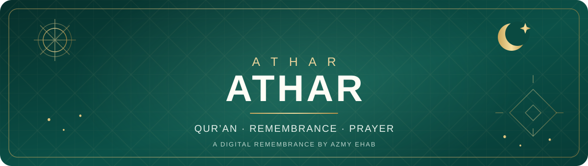

<div align="center">
  

  <p><strong>أثر طيّب يبقى… ودعاءٌ لا ينقطع.</strong></p>
  <p><em>A quiet digital space for the Holy Qur’an, remembrance, and heartfelt prayers.</em></p>

  <p>
    <a href="https://github.com/AZMYEHAB21/-"></a>
    
    
    
    
  </p>
  <p>
    <a href="#نبذة-عن-المشروع">العربية</a> ·
    <a href="#project-overview">English</a> ·
    <a href="#التشغيل-المحلي">التشغيل</a> ·
    <a href="#المطور-والحقوق">المطور والحقوق</a>
  </p>
</div>

---

## نبذة عن المشروع

**أثر (Athar)** موقع ويب عربي ذو اتجاه كتابة من اليمين إلى اليسار (RTL)، أُنشئ ليكون مساحة هادئة لقراءة القرآن الكريم، والمحافظة على الأذكار، وقراءة الأدعية، والتذكّر بالدعاء للمرحوم **محمود عزمي العمري**، رحمه الله.

يجمع الموقع بين محتوى تعبّدي بسيط وتجربة استخدام متجاوبة، مع أدوات تساعد على متابعة القراءة وحفظ التفضيلات على جهاز الزائر.

> **الفكرة:** قد تبقى آية تُقرأ، أو ذكرٌ يُقال، أو دعوةٌ صادقة… أثرًا طيبًا لا يُنسى.

## أبرز المميزات

| القسم | ما يقدّمه |
|---|---|
| **القرآن الكريم** | استعراض السور، والبحث في الآيات بالتشكيل أو بدونه، وتكبير النص وتصغيره، وفتح آية عشوائية. |
| **التلاوة الصوتية** | اختيار قارئ من مجموعة قرّاء، والتحكم في سرعة التشغيل والتكرار، والانتقال بين الآيات، ومتابعة موضع القراءة. |
| **علامات القراءة** | حفظ الآيات المفضلة واسترجاع آخر موضع وصلت إليه باستخدام التخزين المحلي في المتصفح. |
| **الأذكار** | مجموعات مصنّفة لأذكار اليوم ومناسباته، مع عدادات لحفظ التقدّم على الجهاز. |
| **الدعاء للمرحوم** | أدعية للمتوفى مع أدوات النسخ والمشاركة. |
| **أحاديث مختارة** | صفحة لقراءة أحاديث مختارة مع الإشارة إلى مصادرها. |
| **العلم النافع** | مقالات قصيرة في العبادات والأخلاق والعمل الصالح. |
| **مواسم الخير** | تذكيرات ومقترحات لأعمال صالحة في مواسم ومناسبات إيمانية مختلفة. |
| **تجربة الاستخدام** | تصميم متجاوب، وقائمة مناسبة للهواتف، ووضع فاتح/داكن، وإمكانية مشاركة الموقع. |
| **تطبيق ويب تقدّمي (PWA)** | ملف Manifest وService Worker لتثبيت الموقع كتطبيق ودعم التخزين المؤقت لبعض الملفات الأساسية. |

## Project Overview

**Athar (أثر)** is an Arabic, right-to-left (RTL) website dedicated to Qur’an reading, daily remembrance, supplications, selected Hadith, and short educational content. It also serves as a digital remembrance of **Mahmoud Azmy El Omary** — may Allah have mercy on him.

The project focuses on a calm reading experience, responsive layouts, lightweight browser-native technologies, and local persistence for reading preferences and progress.

### Highlights

- Qur’an browsing and search with Arabic diacritics normalization.
- Audio reciter selection, playback-speed control, repeat modes, and verse navigation.
- Saved verses and a remembered last-reading position.
- Categorized adhkar with locally persisted counters.
- Supplication, copy, and share interactions.
- Light and dark themes, mobile navigation, and responsive styling.
- PWA manifest and a service worker that caches selected local resources.
- Basic search-engine metadata, `robots.txt`, and `sitemap.xml`.

## صفحات الموقع

| الملف | الصفحة |
|---|---|
| [`index.html`](index.html) | الصفحة الرئيسية والتذكير بالدعاء |
| [`quran.html`](quran.html) | القرآن الكريم والبحث والتلاوة |
| [`azkar.html`](azkar.html) | الأذكار والعدادات |
| [`duas.html`](duas.html) | الدعاء للمرحوم |
| [`hadith.html`](hadith.html) | أحاديث مختارة |
| [`ilm.html`](ilm.html) | العلم النافع |
| [`seasons.html`](seasons.html) | مواسم الخير |
| [`about.html`](about.html) | قصة الموقع وفكرته |

## التقنيات المستخدمة

- **HTML5** — بناء الصفحات والمحتوى الدلالي.
- **CSS3** — الهوية البصرية، السمات، والحركة والاستجابة لأحجام الشاشات.
- **Vanilla JavaScript** — التفاعل، البحث، مشغّل الصوت، وحفظ تفضيلات المستخدم.
- **Web Storage API (`localStorage`)** — حفظ التفضيلات والتقدّم محليًا في المتصفح.
- **Web App Manifest + Service Worker** — خصائص تطبيق الويب التقدّمي والتخزين المؤقت للموارد المحلية المحددة.
- **AlQuran Cloud API** — جلب بيانات القرآن ونصوص الآيات.
- **AlQuran Cloud Audio CDN / EveryAyah** — مصادر التلاوات الصوتية بحسب القارئ.

لا يحتوي المشروع على خادم خلفي (Backend) مخصّص أو إطار عمل JavaScript؛ فهو مشروع واجهة أمامية ثابتة يعتمد على HTML وCSS وJavaScript.

## هيكل المشروع

```text
.
├── index.html                 # الصفحة الرئيسية
├── quran.html                 # المصحف والبحث والتلاوة
├── azkar.html                 # الأذكار
├── duas.html                  # الأدعية
├── hadith.html                # أحاديث مختارة
├── ilm.html                   # العلم النافع
├── seasons.html               # مواسم الخير
├── about.html                 # عن الموقع
├── site.config.js             # إعدادات وبيانات الموقع العامة
├── manifest.json              # إعدادات تطبيق الويب التقدّمي
├── sw.js                      # Service Worker والتخزين المؤقت
├── robots.txt                 # تعليمات زواحف البحث
├── sitemap.xml                # خريطة الموقع
├── css/
│   ├── main.css               # الأنماط الأساسية
│   └── responsive.css         # أنماط الشاشات المختلفة
├── js/
│   ├── app.js                 # التنقل والسمات والمشاركة والوظائف المشتركة
│   ├── quran.js               # منطق القرآن والبحث والتلاوة
│   ├── azkar.js               # واجهة الأذكار والعدادات
│   ├── duas.js                # وظائف الأدعية
│   └── hadith.js              # وظائف الأحاديث
├── data/
│   ├── azkar.js               # بيانات الأذكار
│   ├── duas.js                # بيانات الأدعية
│   └── hadith.js              # بيانات الأحاديث
└── assets/
    ├── icons/                 # أيقونات الموقع وPWA
    └── images/                # الصور والأصول المرئية، ومنها readme-banner.svg
```

## التشغيل المحلي

### المتطلبات

- متصفح حديث مثل Chrome أو Edge أو Firefox.
- اتصال بالإنترنت لطلب بيانات القرآن والتلاوات من المصادر الخارجية.
- خادم محلي بسيط للمعاينة واختبار خصائص PWA؛ لا توجد حزم npm مطلوبة.

### الطريقة الأولى: VS Code Live Server

1. نزّل المشروع أو استنسخه.
2. افتح مجلد المشروع في Visual Studio Code.
3. شغّل `index.html` باستخدام إضافة **Live Server**.
4. افتح عنوان المعاينة المحلي الذي تعرضه الإضافة.

### الطريقة الثانية: Python

من داخل مجلد المشروع، نفّذ:

```bash
python -m http.server 5500
```

ثم افتح:

```text
http://localhost:5500
```

> يُفضّل استخدام خادم محلي بدل فتح الصفحة مباشرة عبر `file://` حتى تعمل خصائص مثل Service Worker ضمن بيئة مناسبة.

## البيانات والخصوصية

- تُحفظ تفضيلات مثل المظهر وحجم خط القرآن والقارئ وسرعة التلاوة، بالإضافة إلى العلامات وموضع القراءة وتقدّم عدادات الأذكار، في `localStorage` على متصفح المستخدم.
- لا يتضمن المشروع نظام حسابات مستخدمين أو Backend خاصًا.
- تحميل نصوص القرآن والتلاوات يعتمد على خدمات خارجية؛ لذلك قد تتأثر هذه الوظائف بتوفّر الإنترنت أو الخدمات المزوّدة.
- يقوم Service Worker بتخزين بعض الصفحات والملفات المحلية مؤقتًا؛ **ولا يعني ذلك أن جميع البيانات الصوتية أو بيانات القرآن الديناميكية متاحة دون اتصال**.

## ملاحظات التطوير

- إعدادات الموقع العامة موجودة في `site.config.js`.
- بيانات الأذكار والأدعية والأحاديث منفصلة داخل مجلد `data/` لتسهيل صيانتها.
- منطق الصفحات موزّع داخل مجلد `js/`، بينما تتولى ملفات `css/` تنسيق الواجهة والاستجابة.
- عند تعديل قائمة الملفات الأساسية التي يحتاجها الموقع، راجع مصفوفة `CORE` داخل `sw.js` لضمان توافق التخزين المؤقت مع الملفات الحالية.

## المطور والحقوق

<div align="center">
  <h3>AZMY EHAB · عزمي إيهاب</h3>
  <p><strong>Design & Development</strong></p>
  <p>
    <a href="https://github.com/AZMYEHAB21"></a>
    <a href="https://wa.me/201220373091"></a>
    <a href="https://instagram.com/azmy_ehab_"></a>
  </p>
</div>

**حقوق الملكية:** © 2026 AZMY EHAB. جميع الحقوق محفوظة ما لم يُذكر خلاف ذلك صراحةً. لا يتضمن المستودع حاليًا ملف ترخيص مفتوح المصدر؛ ووجود الكود بصورة عامة على GitHub لا يعني منح إذن تلقائي بإعادة استخدامه أو إعادة توزيعه.

<!-- Add a publicly shareable email here when ready; no email address was present in the supplied project or public profile. -->

## رسالة المشروع

هذا الموقع تذكرة بسيطة بالدعاء للمرحوم **محمود عزمي العمري**. نسأل الله أن يغفر له ويرحمه، وأن يجعل كل قراءة وذكر ودعاء فيه أثرًا طيبًا ورحمةً ونورًا.

<div align="center">
  <sub>Built with care by <a href="https://azmyehab21.github.io/Social-media/">AZMY EHAB</a> · أثر يبقى</sub>
</div>
